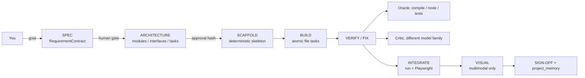

# crew-tui — Hierarchical AI Software Factory

[](https://github.com/miguelserra/crew-tui/actions/workflows/ci.yml)
[](https://www.python.org/)
[](#windows-11)
[](LICENSE)

A deterministic, **verifiable** multi-agent software factory in a terminal UI.
Instead of letting one LLM "just write code", it freezes a spec, splits the work
into atomic tasks, routes each task to a capable model, and refuses to deliver
anything that fails an external oracle plus a cross-model critic.

- **Pipeline:** SPEC → (human gate) → ARCHITECTURE → SCAFFOLD → BUILD →
  VERIFY/FIX → INTEGRATE → VISUAL → SIGN-OFF, with resumable canonical state.
- **Canonical domain:** a single `ProjectState` (requirements, architecture,
  tasks, approvals, verification history); legacy formats are compatibility
  views, not parallel sources of truth.
- **Verification is not optional:** `py_compile` / `node --check` / Playwright
  (console errors + DOM-contract audit) plus a critic from a **different model
  family** that must produce falsifiable objections.
- **Cost-aware routing:** sunk-cost Gemini first, local Qwen for cheap work,
  paid DeepSeek only off-peak, subscription models as a last resort.
- **Portable:** Linux and Windows power backends, `.env`-driven, no CrewAI.

## Architecture



Design principles:

- **SPEC** — the canonical `RequirementContract` inside `ProjectState`
  (objective, scope, constraints, measurable acceptance criteria with explicit
  task traceability) is co-designed with you and frozen **before** any code is
  generated. Legacy `SpecContract` remains a compatibility format.
- **VERIFY** — two independent levers:
  1. an external **oracle** (`py_compile` + optional `ruff` / `node --check`);
  2. a **cross-model critic** (a different model family that must emit
     falsifiable objections, never praise), plus a mandatory fix loop.
- **ENVIRONMENT** — persistent `.env` config, deterministic context guard
  (local worker never receives >`LOCAL_SAFE_TOKENS` tokens; large contexts go
  through a larger model), thread-safe callback layer (no `print()`).

## Quick start (Linux / macOS)

```bash
python3 -m venv .venv
source .venv/bin/activate
pip install -r requirements.txt
cp .env.example .env        # then add your keys (see below)
python main.py              # or: ./run.sh
```

Requires Python 3.10+ (tested on 3.14). `crewai` is **not** used.

## Windows 11

Use the bundled PowerShell scripts:

```powershell
# From the project folder, in PowerShell:
.\setup.ps1 -Playwright -Node   # venv + deps + %APPDATA%\crew-tui\.env
notepad $env:APPDATA\crew-tui\.env   # add your keys
.\run.ps1                            # TUI
.\run.ps1 "build a todo app" --project C:\dev\todo --yes --approve-architecture
```

- `setup.ps1` creates `.venv`, installs `requirements-windows.txt`, and copies
  the config template. `-Playwright` installs Chromium for the visual audit;
  `-Node` installs Node.js (for JS/TS oracle checks).
- The Windows power backend keeps the PC awake and pauses at peak **without
  suspending** (it waits awake until off-peak).
- On Windows the config lives in `%APPDATA%\crew-tui\.env`; on Linux/macOS in
  `~/.config/crew-tui/.env`. A project-local `.env` overrides both.

## Set your API keys

Configuration is read from, in order of precedence (highest wins):

1. real environment variables;
2. a project-local `.env`;
3. the per-user config (`%APPDATA%\crew-tui\.env` on Windows,
   `~/.config/crew-tui/.env` on Linux/macOS);
4. built-in defaults.

Every key is **optional** — roles degrade gracefully (e.g. no cloud key means
local + Gemini only). The minimum useful setup is one strong cloud key:

```dotenv
# Pick what you have; all are optional.
GEMINI_API_KEY=...        # Gemini Plus: large context + multimodal critic
DEEPSEEK_API_KEY=...      # pay-as-you-go, used off-peak for hard reasoning
OPENCODE_API_KEY=...      # OpenAI-compatible subscription gateway (last resort)
OPENROUTER_API_KEY=...    # optional free models
```

Then set the model names you want (see the next section). Keys are never
written to disk by the app beyond the `.env` file you edit yourself, and
`.env` is git-ignored. Never commit real keys.

## Engine selection and canonical state

There is a **single Crew entry**: an ordinary instruction (TUI) or a
positional goal (CLI, `crew-tui "objetivo" --project DIR`) starts the workflow.
`/factory` and `--factory` are deprecated aliases that forward to the same
entry with a warning; they are not a separate product mode.

`CREW_ENGINE` selects the engine for **new** executions:

```dotenv
CREW_ENGINE=legacy    # default in P1 (strangler)
CREW_ENGINE=unified   # new canonical state + corrected phase order
```

- New runs persist exactly one canonical file: `.crew/state.json` (unified) or
  `.factory/state.json` (legacy, with additive `engine_kind`/`engine_version`/
  `schema_version` metadata). There is no permanent dual-write.
- `--resume` uses the engine stored in the state; changing `CREW_ENGINE` does
  not switch a running/resumed execution. An unavailable engine or a future
  schema is a hard error, never a silent fallback.
- Format migration and engine migration are separate:
  `--migrate-state --project DIR` converts `.factory` to `.crew` **without**
  changing the engine; `--migrate-engine --project DIR` validates that the
  state is resumable by unified (phases, tasks, dependencies, contracts,
  checkpoints), snapshots it under `.crew/history/`, and only then flips
  `engine_kind` transactionally. The old files are preserved for rollback.
- The architecture gate is independent from `--yes`: headless runs need
  `--approve-architecture`. `--yes` only answers questions/assumptions.
- Models whose billing cannot be proven are blocked unless
  `--allow-unknown`/`ALLOW_UNKNOWN=1` is explicit.
- Corrupt state raises and is preserved; it is never replaced by an empty state.

## Canonical contracts (P2)

`ProjectState` is the aggregate root and the only in-memory source of truth:

- **RequirementContract** — objective, scope, constraints and acceptance
  criteria. Each criterion has an `id`, `text`, `task_ids` and an optional
  explicit `justification`; `link_traceability`/`validate_traceability` close
  Requirement → Task → Verification.
- **ArchitectureContract** — modules, interfaces and test plan.
- **Task** — kind (`build|review|prose`), target file, role/complexity,
  acceptance, dependencies and `requirement_ids`; the DAG rejects missing
  dependencies and cycles.
- **Approval** — the architecture hash covers the architecture contract, every
  task plan field (including files, acceptance, dependencies and requirement
  links) and the traceability mapping. Any plan change re-closes the gate;
  progress/status changes do not.
- **VerificationRecord** — verdict plus `criterion_ids` and oracle/critic/
  visual/integration history.

Schema control is explicit:

```bash
crew-tui --migrate-schema --project DIR    # .crew v2 -> v3 (no engine change)
crew-tui --migrate-state  --project DIR    # .factory -> canonical .crew v3
crew-tui --migrate-engine --project DIR    # v3 only; validates and snapshots
```

A v2 `.crew` is never upgraded silently on load. Unmapped legacy fields are
preserved in `ProjectState.extensions`, contract `raw` data and
`Task.legacy_extra`.

## Model Registry (P3)

`models.toml` is the formal source of model knowledge:

- identity = **provider + endpoint + model_id + credential_profile** (not the
  display name);
- billing = `local | free_quota | subscription | payg | unknown`;
- explicit capabilities (`text`, `vision`, `json`, `tools`);
- Decimal prices per 1M tokens, currency, provenance and `pricing_updated`;
- OpenRouter is `free_quota` only when **both** confirmed prices are zero;
- subscriptions/free quotas track quota consumption separately from PAYG cost;
- `ModelRef` stores an identity snapshot for historical attempts/telemetry;
- Python 3.10 uses `tomli`; 3.11+ uses `tomllib`.

## Router (P4)

Routing is a central policy over Registry identities, not a chain of
`with_fallbacks` guesses:

- **Fallback** handles technical failure only: timeout (limited retry),
  connection, 429 rate limit (respecting `Retry-After`), quota exhaustion
  (tracked separately), 5xx and empty responses.
- **Escalation** is a quality decision after oracle/critic failure: it uses a
  stronger chain and excludes the producer that failed.
- **Circuit breaker** is keyed by provider + endpoint + credential profile:
  3 rate limits within the window open a 15-minute cooldown, a half-open probe
  is allowed before closing, and the state survives restarts
  (`logs/router_state.json`). Auth failures disable the credential; quota has
  its own cooldown.
- **PAYG grants are scoped**: a TUI approval authorizes one task; `--allow-paid`
  is a run-scoped grant. There is no persistent global “allow paid” switch.
  Every fallback/escalation candidate still passes the Registry billing gate;
  `unknown` remains blocked.
- **Complexity comes from `Task.complexity`** when present; the token heuristic
  is only an `auto` fallback:

| Complexity | Chain |
|---|---|
| tiny / local helper | Qwen local (if up) → normal free chain |
| normal coding | Gemini Flash → Flash alt → Pro → Nemotron → Argon |
| complex / architecture | Gemini Pro → Nemotron → Kimi/Argon → DeepSeek PAYG |
| fixer | Big Pickle (only if available) → Gemini Pro → stronger authorized candidates |

The Router returns ordered candidates with reasons; it never constructs
LangChain clients (the provider/LLMPool layer does).

## Verification engine (P5)

Delivery requires independent evidence, not just a successful model call:

- **Critic is mandatory and cross-family**: the producer comes from
  `Task.delivered_by` (or the last generation attempt), never from the role
  label; every critic candidate must have a different model family. A
  same-family critic is invalid, and critic fallbacks are also cross-family.
- **Critic unavailable → UNVERIFIED**, not PASS. Build tasks are not delivered
  unless `ALLOW_UNVERIFIED=1`/`--allow-unverified` is explicitly set; the
  exception is recorded in the verification evidence and run result.
- **Oracle**: compile/static checks are deterministic evidence.
- **Qwen local test is advisory**: it can inform a fix but cannot be the sole
  reason to reject or accept a delivery.
- **Visual** uses only Registry identities with the `vision` capability.
  `N/A` means visual review is not applicable; `UNVERIFIED` means it was
  required but no vision model was available. Text-only models never receive
  images.
- **Review exception**: a review report may be delivered with documented
  objections if the critic actually ran; the code verification remains FAIL,
  not PASS.
- Evidence is stored in `VerificationRecord` (oracle, critic identity/family,
  visual, advisory tests, verdict, reasons) and surfaced in results.

`verify.py` owns the delivery policy; `main.Verifier` collects evidence and
the Factory/Orchestrator call the same gate.

## Workflow profiles and recoverable delivery (P6/P6.1)

New unified runs separate **production** from **delivery**:

- **Profile** (`auto|web|library|script|review`) determines the phases and
  mandatory checks. `auto` is resolved from requirements/architecture/tasks
  (UI/browser → web; library/API/test hints → library; otherwise script),
  persisted as `profile_selection` with a reason/version, and never recomputed
  silently on `--resume`. A profile change invalidates the architecture
  approval because the profile is part of the approved plan hash.
- **Scaffold is deterministic** from `ArchitectureContract`/task targets:
  directories, empty files, preserve existing content, case-insensitive and
  symlink validation, manifest, idempotent, zero LLM calls.
- **Workspace isolation**: the user's `project_root` is only the destination.
  BUILD, VERIFY, INTEGRATE, Playwright and VISUAL operate on an isolated
  `workspace_root` seeded from the project. A `WorkspaceManifest` validates
  integrity: an original file missing from the workspace blocks publish
  unless an approved `DeletionOperation` covers it.
- **Ignore safety**: mandatory security exclusions (`.env*` except templates,
  keys, `.ssh`, `.aws`), technical exclusions (`.venv`, `.git`, `bin`, `obj`,
  `.vs`, `.vscode`, `node_modules`, caches) and `.crewignore`/`.gitignore`
  patterns. Excluded files and reasons are recorded in the workspace report.
- **Recoverable publish** happens only after all gates and SIGN-OFF:
  immutable generated snapshots, backups, journal states
  (`PREPARED`/`PUBLISHING`/`ROLLING_BACK`/`RECOVERY_REQUIRED`/`COMMITTED`/
  `ROLLED_BACK`), per-file atomic replacement, hash-aware rollback,
  corruption detection and a per-project publish lock. This is **per-file
  atomic replacement with a journal**, not a global multi-file transaction.
- Human edits/deletions of files Crew changed block publication; unchanged
  files are skipped. A conflict is resolved with
  `--resolve-publish-conflict --project DIR --journal ID --file REL
  --choice human|original|generated|manual`; a choice other than the tested
  generated version requires revalidation and is never marked `DONE`
  automatically.
- **Approved deletions** are explicit `DeletionOperation`s bound to the
  architecture hash, requirement and expected file hash; they are backed up,
  journaled and reversible. LLM-inferred deletions are not accepted.
- P6/P6.1 applies to the unified engine; the legacy Factory path remains for
  compatibility until P7.

## Financial circuit breaker

Pay-as-you-go models are **never** called implicitly:

- The Model Registry (`models.toml`) assigns each model an explicit
  `billing` class: `local`, `free_quota`, `subscription`, `payg` or `unknown`.
  Subscriptions and free quotas consume quota; they are **not** reported as
  zero-cost PAYG calls. Unknown models are blocked without authorization.
- Fallback chains are built without `payg` handles unless `ALLOW_PAID=1`.
- A free-tier `429`/quota that exhausts the chain suspends the run with
  `BudgetSuspended` instead of silently falling back to a paid endpoint.
- In the TUI, a modal asks which paid model to use **for that task**; refusing
  keeps the breaker closed (the step fails, nothing is spent). A task grant
  never authorizes another task. `--allow-paid` is an explicit run-scoped grant.
- The router circuit breaker is separate from billing: 3 rate limits →
  cooldown (respecting `Retry-After`), a half-open probe, persistent state;
  quota exhaustion and auth failure are distinct states.
- Headless factory: use `--allow-paid` (or `ALLOW_PAID=1`) to pre-authorize.

```dotenv
ALLOW_PAID=0          # 1 only for unattended runs that may spend money
PAYG_MODELS=          # extra per-token ids; prefer adding them to models.toml
```

## Adapting to other models or providers

All model selection is **environment-driven**, but model identity, capabilities,
billing and pricing come from the **Model Registry** in `models.toml` (override
with `MODELS_CONFIG=/path/to/models.toml`). Add custom model ids there; an
unregistered non-local model is `unknown` and blocked by the dispatch guard.

### Role → variable → default

| Role | Variable | Default |
|---|---|---|
| Manager / spec | `FIELD_MARSHAL_MODEL` | `deepseek-v4-pro` |
| Manager 429 fallback | `FALLBACK_MODEL` | `kimi-k3.1-pro` |
| Architect / planner | `ARCHITECT_MODEL` | `kimi-k3.1-pro` |
| Gemini workhorse | `GEMINI_MODEL` | `gemini-3.5-flash` |
| Gemini Pro / critic | `GEMINI_PRO_MODEL` | `gemini-3.1-pro-preview` |
| Fast cloud worker | `FAST_CLOUD_MODEL` | `deepseek-v4.1-flash` |
| Reviewer / argon | `REVIEW_MODEL` | `gemini-4-argon` |
| Senior dev / fixer | `SENIOR_MODEL` | `big-pickle` |
| Local worker | `LOCAL_MODEL_NAME` | `qwen3.6-35b-a3b` |

To swap models, change the value and (if needed) the endpoint:

```dotenv
# Any OpenAI-compatible gateway (OpenRouter, DeepSeek, vLLM, Ollama, LM Studio…)
OPENCODE_BASE_URL=https://api.openai.com/v1   # or your gateway
OPENCODE_API_KEY=sk-...
FIELD_MARSHAL_MODEL=gpt-5.1
ARCHITECT_MODEL=gpt-5.1-mini
FAST_CLOUD_MODEL=gpt-5.1-mini
```

### Run fully local

Point the worker at a local OpenAI-compatible server and leave cloud keys empty:

```dotenv
LOCAL_LLM_URL=http://127.0.0.1:8081/v1     # llama.cpp / vLLM / Ollama / LM Studio
LOCAL_MODEL_NAME=your-local-model
LOCAL_START_CMD=                            # e.g. ollama serve, optional
# no OPENCODE/GEMINI/DEEPSEEK keys -> roles fall back to local only
```

### Add a brand-new provider

The pool wraps four client types in `main.py` (`LLMPool`): `_cloud` (generic
OpenAI-compatible), `_gemini` (native Google), `_openrouter`, and `_deepseek`.
Most providers need **no code** — use `OPENCODE_BASE_URL` + `_cloud`. Only a
provider with a non-OpenAI protocol needs a new `_yourprovider()` builder and a
line in `_build()`; the role chains then pick it up. Per-role reasoning is
controlled by the `THINK_*` variables.

## Run

```bash
./run.sh                 # uses .venv automatically
# or manually:
source .venv/bin/activate && python main.py
```

On Windows use `.\run.ps1`.

Type an instruction and press Enter. The flow:

1. **PLAN** — the architect proposes a short, human-readable plan (goal, ordered
   steps, how it will be verified) plus **2-5 open questions**. Answer them one
   per submission; the plan is refined and remaining questions shrink. Nothing
   is built yet. Type **`go`** when you are happy (Enter alone does *not* start).
2. **BUILD** — each small task is delegated to the matching team/model.
3. **VERIFY** — oracle + critic (+ visual/test oracles); failed tasks are rebuilt
   (feedback loop) before anything is written into the project.
4. **DONE** — review; type a new instruction, ask what happened, or refine.

While it runs, the TUI is a dashboard (not a code stream):

- **AGENTES** — who is working now, on which model, tokens and elapsed time.
- **TAREFAS** — task board with status (`pend`/`corre`/`feito`/`ok`/`falhou`).
- **MÉTRICAS** — tokens in/out, estimated cost, free/paid mix (`L` local,
  `G` free Gemini, `F` free API, `P` paid), verification counters.
- **AVISOS** — 429/quota, timeouts, fallbacks, failed tasks, critic unavailable.
- The compact log keeps only the last events (`STREAM_MODE=progress` by default;
  `full` streams code, `off` silences it).

## Software factory (single Crew entry)

Hierarchical workflow with a single canonical `ProjectState`. In the TUI an
ordinary instruction starts it; `/resume` continues from persisted state:

```
<descreve o objetivo>          # entrada única (SPEC → ... → SIGN-OFF)
go                             # aprova o SPEC e, mais tarde, a arquitetura
/resume                        # retoma do estado persistido
```

`/factory` and `--factory` are deprecated aliases with a warning. Headless:

```bash
crew-tui "objetivo" --project ~/projetos_opencode/foo --yes --approve-architecture
crew-tui --resume --project ~/projetos_opencode/foo
```

| Fase | Papel | Modelo | Output |
|---|---|---|---|
| 1 REQUIREMENTS/SPEC | analista sénior (terso) | Gemini/Argon | critérios de aceitação + perguntas |
| 2 ARCHITECTURE | engenheiro-chefe | Gemini Pro → Argon | módulos, interfaces, tarefas, plano de testes |
| 3 SCAFFOLD | júnior | Qwen local/Gemini | esqueleto de ficheiros (determinístico em P6) |
| 4 BUILD | sénior/júnior por tarefa | Gemini/Argon, Qwen | ficheiros + `py_compile`/`node --check` |
| 5 VERIFY/FIX | sénior → chefe | Gemini → Argon | oráculo + crítico + ciclos de correção |
| 6 INTEGRATE | execução real | — | run do entrypoint / Playwright |
| 7 VISUAL | browser + visão | Playwright + Gemini | `ui_report` + screenshot |
| 8 SIGN-OFF | chefe | Gemini Pro → Argon | `project_memory.json` |

Artefactos: `.crew/state.json` é o estado canónico (schema v3);
`.factory/state.json` é uma vista de compatibilidade para execuções legacy;
`.factory/logs/`, `candidates/`, `backups/`, `tests/` e `project_memory.json`
continuam a ser artefactos por projeto.

**Auditoria Playwright (sem LLM):** carrega `index.html` em Chromium headless e falha
com erros de consola/página, pedidos 404 e *contratos DOM* — IDs usados pelo JS/CSS
que não existem no HTML. É esta a rede que apanha o caso `#title-screen` vs
`#title-overlay`.

## Pointing at a folder ("trabalha na pasta X")

If your instruction contains a folder path (e.g. `@~/projetos/foo` or a bare
`/home/user/projetos/foo`), the system reads the folder into a bounded,
privacy-safe context brief (file tree + contents) and injects it into the spec
and build prompts. It:

- skips `.git`, `.venv`, `node_modules`, caches, binaries and secrets
  (never reads `.env`, `*.pem`, `*.key`, `id_rsa*`);
- caps the scan (`SCAN_MAX_FILES`, `SCAN_MAX_CHARS_PER_FILE`, `SCAN_TOTAL_CHARS`).

You can also set `PROJECT_DIR` in `.env` to always use a default folder.

## Model roles (colour-coded in the TUI)

| Tag | Model | Role |
|---|---|---|
| `[FIELDMARSHAL]` (red) | `deepseek-v4-pro` + `kimi-k3.1-pro` fallback (429) | spec/manager |
| `[ARCHITECT]` (blue) | `gemini-3.1-pro-preview` (thinking) + kimi fallback | plan/design, algorithms |
| `[PLAN]` (bright blue) | — | human-readable plan + questions |
| `[GEMINI]` (purple) | `gemini-3.5-flash` (thinking) | workhorse generator, UI/UX |
| `[WORKER]` (green) | local Qwen, else `beam-free` | execution / boilerplate |
| `[DEV]` | `big-pickle` (free zen) → Gemini Pro → off-peak DeepSeek | senior dev + fixer |
| `[CRITIC]` (yellow) | opposite family of the producer | falsification review |
| `[ORACLE]` (cyan) | `py_compile`/`ruff`/`node --check` | external signal |

## Reasoning levels

Thinking is controlled per role (`THINK_*` env vars, `1`/`0`):

- ON (default): `FIELDMARSHAL`, `ARCHITECT` — design/planning benefits from
  reasoning (`REASONING_EFFORT=low|medium|high` → `reasoning_effort`).
- OFF (default): `WORKER`, `CRITIC`, `FAST_CLOUD`, `GEMINI` — fast/structured
  roles send `enable_thinking: false` (DeepSeek/Kimi/llama.cpp template param;
  Gemini uses `thinking_budget=0`), so the token budget goes to output, not
  `<think>` blocks.

Gemini "too busy"/rate-limit handling: the Gemini role runs
`GEMINI_MODEL` with an automatic fallback to `GEMINI_FALLBACK_MODEL`
(default `gemini-3.8-flash`) on API errors/429 — the API equivalent of the
consumer app's Pro→Flash downgrade, but under your control.

## Stealth senior dev / fixer

The senior developer (`role=senior`) and the fixer prefer the free
`big-pickle` model (`SENIOR_MODEL`, served from `SENIOR_BASE_URL`, the free
zen endpoint). Because that endpoint currently answers `429 FreeUsageLimitError`
to API clients, the pool probes it once at startup and only puts it in the
chain when it actually replies. Order: `big-pickle` → `GEMINI_PRO_MODEL` →
the Gemini workhorse chain → off-peak DeepSeek. If the model is pulled or
priced, the chain degrades to the already-paid Gemini with no code change.
Set `SENIOR_PROBE=0` to never use it, `SENIOR_FORCE=1` to pin it as primary
even when the probe fails (each task then pays one 429 before falling back),
or point `SENIOR_BASE_URL` at the Go endpoint once it is available there.

## OpenCode Go as a last resort

`OPENCODE_MODE` controls the paid subscription endpoint:

- `last` (default) — local Qwen and the sunk-cost Gemini Plus carry the work;
  OpenCode Go models are appended at the end of every chain.
- `primary` — legacy behaviour (Go models first).
- `off` — the key is ignored entirely (use when the subscription ends).

The manager, architect, reviewer, escalation, QA and worker fallbacks are all
ordered accordingly, so switching to `off` requires no code change.

## Pay-as-you-go peak policy

When a direct DeepSeek key is present (`DEEPSEEK_API_KEY`), the architect/chief
chain is routed by the UTC clock:

- **Off-peak** → direct DeepSeek (`DEEPSEEK_MODEL`, default `deepseek-v4-pro`) is
  the primary; Gemini Pro and the Go models become fallbacks.
- **Peak** → Gemini Pro is primary and direct DeepSeek is excluded from the
  architect fallback chain, protecting the pay-as-you-go bill even if Gemini
  fails. OpenRouter/Go remain available as configured fallbacks.

Configure the windows with `PEAK_WINDOWS_UTC` (comma-separated `HH:MM-HH:MM`,
default `01:00-04:00,06:00-10:00`), `PEAK_WEEKDAYS_ONLY=1` and
`PEAK_POLICY=0` to disable. Without a key the policy is inert and routing is
unchanged. Handles are rebuilt automatically when the run crosses a boundary.
Windows follow DeepSeek's official schedule (Mon–Fri 01:00–04:00 and
06:00–10:00 UTC; everything else, including weekends, is off-peak at 50%).

## Power management (keep awake / off-peak sleep)

Long runs are power-aware (`power.py`):

- **Keep awake** (`KEEP_AWAKE=1`) — while a factory/orchestrator run is active,
  crew-tui holds a `systemd-inhibit --what=idle` lock so GNOME's 30-minute
  auto-suspend never cuts a build in half.
- **Off-peak gate** (`SLEEP_OFFPEAK=1`) — at every step/task boundary, if the
  clock is inside a DeepSeek peak window, the run is paused, the RTC alarm is
  armed for the next off-peak start, and the machine suspends (only after
  `OFFPEAK_IDLE_MIN` minutes of user inactivity). On wake it clears the alarm,
  restarts local Qwen, refreshes the pool and continues; DeepSeek is primary
  again. The marker is persisted as `paused_until` in `.factory/state.json`, so
  `crew-tui --resume` picks it up.
- `--unattended` (or `SLEEP_IF_ACTIVE=1`) suspends even if you are using the
  machine. Default is to stay awake and stay paused, so a run never hijacks
  your session.
- Pauses only happen between LLM calls (never mid-request).
- An early wake (keyboard/USB) re-suspends up to 3× instead of resuming during
  peak; after that it waits awake until off-peak. The RTC alarm is always
  cancelled on resume, run end, and interpreter exit (best-effort).

The privileged part is a small helper (RTC alarm needs root):

```bash
sudo bash scripts/install-crew-sleep.sh      # installs /usr/local/sbin/crew-sleep + sudoers
sudo -n /usr/local/sbin/crew-sleep --dry-run --arm $(( $(date -u +%s) + 3600 ))
```

It arms `/sys/class/rtc/rtc0/wakealarm` and calls `systemctl suspend` (not
`rtcwake -m mem`) so the NVIDIA suspend/resume hooks run. The gate invokes the
helper through `sudo -n` (the sudoers rule grants NOPASSWD for this exact
path). If the alarm cannot be armed, or `sudo -n` fails, or suspend is
inhibited, the run stays paused and waits awake with the idle inhibitor still
held — it never sleeps without a guaranteed RTC wake-up. The gate works on
`s2idle` (the current default); `deep` S3 can be tested by changing
`/sys/power/mem_sleep` manually. Without the helper, the gate still pauses but
waits awake. `SLEEP_OFFPEAK` is inert without a `DEEPSEEK_API_KEY` (nothing to
save). Estimated s2idle overhead vs deep S3 is ~5–20 W (≈0.1–0.3 €/month for a
2 h daily pause) — reliability was preferred.

## Configuration

All settings come from env vars (see `.env.example`). Key ones:

- `OPENCODE_API_KEY` — cloud API key.
- `GEMINI_API_KEY` — optional; disables Gemini-only roles if absent.
- `DEEPSEEK_API_KEY` — optional; enables the direct pay-as-you-go routing.
- `LOCAL_LLM_URL` / `LOCAL_MODEL_NAME` — your llama.cpp endpoint/model.
- `LOCAL_START_CMD` — optional on-demand start command for the local server.
- `KEEP_AWAKE=1` — hold an idle inhibitor while a run is active.
- `SLEEP_OFFPEAK=1` — pause at peak, arm RTC, suspend; needs `SLEEP_HELPER` and
  a `DEEPSEEK_API_KEY`.
- `OFFPEAK_IDLE_MIN` / `SLEEP_IF_ACTIVE` — when it is safe to suspend.
- `LOCAL_SERVICE` / `QWEN_RESTART_ON_WAKE` — stop/start Qwen around suspend.

Without a local worker, `WORKER` automatically falls back to `BEAM_FREE_MODEL`
via the OpenCode API. Without `OPENCODE_API_KEY`, only local/Gemini roles run.

## Telemetry & migration

Every agent/team step appends one compact JSON line to `logs/events.jsonl`
(append-only, never rewritten → `git diff`-friendly). Events carry **metadata +
hashes only** — the actual payloads (spec, generated code/reports) live as
files under `specs/` and `workspace/<run-id>/` and are referenced by `sha`.

Event kinds: `run_start`, `spec_frozen`, `spec_refined`, `spec_fallback`,
`task_start`, `task_built`, `task_rebuilt`, `task_verified`, `task_failed`,
`task_skipped`, `llm_call`, `oracle`, `critic`, `feedback_loop`,
`context_compress`, `run_done`.

- Rotates automatically at `LOG_MAX_BYTES` (default 10 MB) to `logs/events.<ts>.jsonl`.
- No secrets/PII in logs: content is hashed, never stored inline.

The whole state lives inside the project directory (`logs/`, `specs/`,
`workspace/`, `.env`). To migrate to another machine, copy/`rsync` the project
folder (excluding `.venv/`) and re-run `pip install -r requirements.txt` there.

## Project layout

| Path | What it is |
|---|---|
| `main.py` | Config, `LLMPool` (model routing), `Verifier`, `Orchestrator`, Textual TUI, CLI |
| `factory.py` | Legacy Factory compatibility adapter + Playwright audit + DOM-contract check |
| `state.py` | Canonical `ProjectState`/`Task`/`TaskAttempt`, legacy migration, path validation |
| `store.py` | Atomic canonical store, staging promotion, resume resolution, format migration |
| `registry.py` | Model Registry: identity, billing, Decimal pricing, capabilities |
| `models.toml` | Declarative model identities/profiles/prices (override with `MODELS_CONFIG`) |
| `attempts.py` | Per-candidate attempt scoreboard (stdlib) |
| `engine.py` | Engine selection, approvals, dispatch guard, workflow adapters |
| `router.py` | Route contracts, error classification, circuit breaker, PAYG grants |
| `verify.py` | Critic validity, UNVERIFIED semantics and delivery gate |
| `profiles.py` | Workflow profiles, auto resolution and phase sets |
| `scaffold.py` | Deterministic scaffold from the approved architecture |
| `workspace.py` | Workspace seeding and publish planning |
| `publish.py` | Journaled, recoverable transactional publish |
| `peak.py` | Pure peak/off-peak window helpers (shared, no I/O) |
| `power.py` | Platform dispatcher (Linux vs Windows) |
| `power_linux.py` | `systemd-inhibit` keep-awake + RTC alarm/suspend gate |
| `power_win.py` | `SetThreadExecutionState` keep-awake + pause-awake gate |
| `scripts/crew-sleep` | Root helper that arms the RTC alarm / suspends (Linux) |
| `scripts/install-crew-sleep.sh` | One-time root install + sudoers rule |
| `setup.ps1`, `run.ps1` | Windows bootstrap and launcher |
| `tests/` | Power, budget, P0/P1 foundation, P2 contracts, P3 registry, P4 router, P5 verification, P6 workspace/publish and P6.1 recovery tests |

## Tests & CI

```bash
python -m unittest discover -s tests -p "test_p01_*.py"   # core, no deps
python -m unittest discover -s tests -p "test_p02_*.py"   # core, no deps
python -m unittest discover -s tests -p "test_p03_*.py"   # registry, no deps
python -m unittest discover -s tests -p "test_p04_*.py"   # router, no deps
python -m unittest discover -s tests -p "test_p05_*.py"   # verification, no deps
python -m unittest discover -s tests -p "test_p06_*.py"   # profiles/scaffold/workspace, no deps
python -m unittest discover -s tests -p "test_p061_*.py"  # publish safety/recovery, no deps
.venv/bin/python -m unittest discover -s tests -p "test_p0*_integration.py"
python tests/test_power.py
python tests/test_budget.py
```

GitHub Actions byte-compiles every module and runs the core suites on Linux
(Python 3.10, 3.12 and 3.13) and Windows (3.13), plus dependency-backed
integration tests on Linux and Windows (no API keys). The Linux RTC/suspend
integration test is skipped on headless CI runners.

## License

MIT — see [LICENSE](LICENSE).
